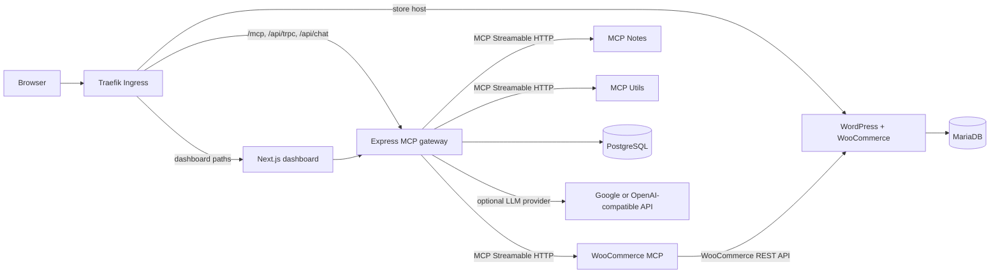

# WooCommerce MCP Gateway

A self-hosted WooCommerce demo platform and team MCP gateway. The dashboard,
chat agent, and external MCP clients share one authenticated gateway. The
platform runs on local k3d or a k3s VPS using the same Helm chart and
environment-specific values files.

## Architecture



The gateway authenticates each MCP request, routes tools to enabled upstreams,
and writes user-attributed audit records. The web app is a UI; credentials and
LLM keys remain server-side.

## Prerequisites

For the one-command local Kubernetes deployment, install and start:

- Docker Engine or Docker Desktop, with at least 4 CPUs and 8 GB memory
  allocated (10 GB is more comfortable while building all five images).
- `bash`, `openssl`, `curl`, `git`, `kubectl`, Helm 3, and k3d.
- A network connection for pulling base images, container dependencies, and
  the WooCommerce plugin during the first store setup.

On Windows, use WSL2 or Git Bash with Docker Desktop's Kubernetes/Docker
integration available to those tools. On macOS or Linux, use a terminal with
Docker running. The local ingress uses host port 8080; the demo hostnames
`dashboard.localtest.me` and `shop.localtest.me` resolve to loopback.

For local TypeScript development, also install Node.js 22 and pnpm 9. Docker
builds install workspace dependencies themselves, so Node and pnpm are not
required just to run the local cluster.

## Start the full local platform

From the repository root:

```bash
# Only if .env does not exist yet:
cp .env.example .env
bash scripts/up.sh
```

The script creates/starts the `mcp` k3d cluster, generates missing local
credentials in the ignored root `.env`, creates Kubernetes Secrets in namespace
`platform`, builds and imports the five application images, and installs/upgrades
the Helm release. The first run can take several minutes while images and
WordPress are initialized.

### URLs

| Service                | Local URL                                                                                         |
| ---------------------- | ------------------------------------------------------------------------------------------------- |
| Dashboard and chat     | <http://dashboard.localtest.me:8080>                                                              |
| WooCommerce storefront | <http://shop.localtest.me:8080>                                                                   |
| Gateway health         | <http://dashboard.localtest.me:8080/healthz>                                                      |
| Gateway readiness      | `kubectl port-forward -n platform service/gateway 4000:4000`, then <http://localhost:4000/readyz> |
| MCP endpoint           | <http://dashboard.localtest.me:8080/mcp>                                                          |

### Login credentials

There is no committed default password. The first run creates
`admin@localtest.me` as the dashboard administrator and generates a random
password. WordPress uses the username `admin` and a separately generated
password. Both are saved in the ignored `.env` file at the repository
root. Read them locally with:

```bash
grep -E '^(ADMIN_EMAIL|ADMIN_PASSWORD|WORDPRESS_ADMIN_PASSWORD)=' .env
```

Do not paste these values into source control or support requests. You can set
`ADMIN_EMAIL` and `ADMIN_PASSWORD` in `.env` before the first start to
choose your own dashboard login. `scripts/create-secrets.sh` preserves
credentials on later runs. For chat, configure `LLM_API_KEY` and the provider
settings in `.env`; the store, dashboard, and external MCP API can be
used without an LLM key.

The bundled store setup creates a sample product and enables Cash on Delivery
(COD). The manual and automated demo flow is in [docs/DEMO.md](./docs/DEMO.md).

## Repository layout

| Path               | Purpose                                                                            |
| ------------------ | ---------------------------------------------------------------------------------- |
| `apps/web`         | Next.js dashboard and chat UI                                                      |
| `apps/gateway`     | Authentication, tRPC API, audit logging, MCP gateway, chat route                   |
| `apps/woo-mcp`     | WooCommerce REST API MCP server                                                    |
| `apps/mcp-notes`   | In-memory notes MCP server                                                         |
| `apps/mcp-utils`   | Utility MCP server                                                                 |
| `packages/db`      | Prisma schema, migrations, and database access                                     |
| `packages/schemas` | Shared Zod API schemas                                                             |
| `packages/mcp-kit` | Shared MCP server helpers                                                          |
| `charts/platform`  | Single Helm chart; `values-local.yaml` and `values-prod.yaml` configure deployment |
| `scripts`          | Local cluster, secret, image, startup, and E2E scripts                             |
| `docs`             | Deployment, design decisions, and demo documentation                               |

## Development

Install dependencies and run workspace development tasks. `pnpm dev` and the
root database scripts load the ignored root `.env` automatically:

```bash
pnpm install
docker compose -f docker-compose.dev.yml up -d postgres
pnpm db:generate
pnpm db:migrate
pnpm dev
```

For direct WooCommerce MCP development, set `WC_BASE_URL`,
`WC_CONSUMER_KEY`, and `WC_CONSUMER_SECRET` in `.env`. Build the application
images and import them into the local k3d cluster with
`bash scripts/build-images.sh --local`. Push images to GHCR with
`bash scripts/build-images.sh --push`; see
[docs/container-images.md](./docs/container-images.md). Environment setup for
the gateway and individual MCP servers is described in
[docs/gateway-mcp.md](./docs/gateway-mcp.md) and [docs/woo-mcp.md](./docs/woo-mcp.md).

For a local k3d installation, see [docs/platform-deployment.md](./docs/platform-deployment.md).
For a k3s VPS, follow [docs/DEPLOY-K3S.md](./docs/DEPLOY-K3S.md). Design
constraints and known limitations are in [docs/DECISIONS.md](./docs/DECISIONS.md).
Run the API-level checks with `bash scripts/e2e.sh`; manual camera-ready steps
are in [docs/DEMO.md](./docs/DEMO.md).

## Troubleshooting

- **Port 8080 is already in use:** stop the conflicting process, or use a
  temporary port-forward to Traefik on another local port:
  `kubectl port-forward -n kube-system service/traefik 8081:80`. Then open the
  same `*.localtest.me` URLs on port 8081.
- **`localtest.me` does not resolve:** confirm it resolves to `127.0.0.1`.
  If local DNS filtering interferes, add entries for
  `127.0.0.1 dashboard.localtest.me shop.localtest.me` to the machine's hosts
  file.
- **Docker build, image import, or pods run out of memory/disk:** allocate at
  least 8 GB RAM (10 GB recommended) and enough disk for five image builds,
  WordPress, and both databases. Check `docker system df` before pruning
  unused images.
- **Pods are pending or restart:** inspect `kubectl get pods -n platform`,
  `kubectl describe pod -n platform <pod>`, and
  `kubectl logs -n platform <pod>`. `kubectl get events -n platform
--sort-by=.lastTimestamp` is useful for image-pull and PVC errors.
- **Store setup is still running:** the first install downloads WordPress and
  WooCommerce. Check
  `kubectl logs -n platform job/mcpgateway-platform-store-setup`; wait for the Job to
  complete and for the WordPress pod to become Ready.
- **WooCommerce API authentication fails on an external store:** the
  WooCommerce REST API uses consumer-key authentication. Use a valid HTTPS
  URL and a REST API key with the required read/write permissions. Some HTTP
  proxies strip the Authorization header on plain HTTP; setting
  `WC_PUBLIC_HOST` only sets the Host header and does not enable HTTPS or fix
  proxy header stripping. See [docs/woo-mcp.md](./docs/woo-mcp.md).
- **Chat fails while other features work:** configure a supported provider,
  model, and server-side API key (`LLM_PROVIDER`, `LLM_MODEL`, and
  `LLM_API_KEY`) in `.env`, then rerun `bash scripts/create-secrets.sh`
  and `helm upgrade --install` or `bash scripts/up.sh`.
